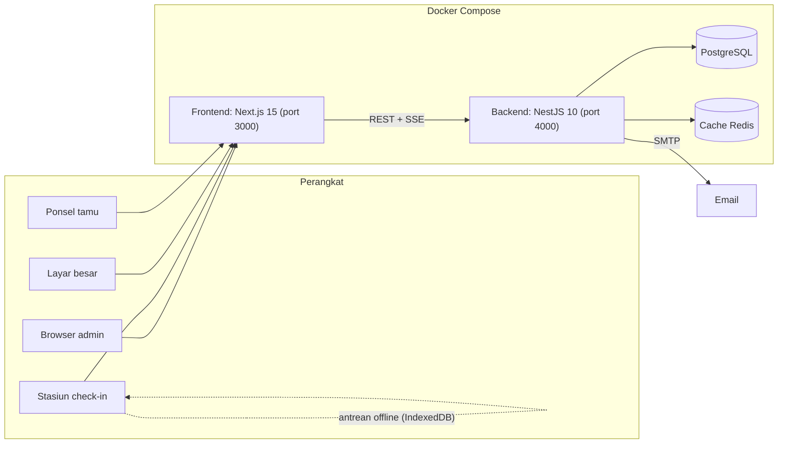

# Event Management System

[English](README.md) · **Bahasa Indonesia**

Platform operasional acara yang mencakup seluruh perjalanan tamu: registrasi, check-in QR di satu atau beberapa stasiun, layar sambutan di display besar, pembagian souvenir, lucky draw, dan turnamen olahraga. Sistem ini dibuat untuk gathering perusahaan, ketika ratusan sampai ribuan tamu datang dalam waktu singkat dan meja check-in harus tetap berjalan walaupun jaringan bermasalah. Versi saat ini: 1.6.0. Antarmukanya berbahasa Indonesia.


## Daftar isi

- [Fitur](#fitur)
- [Halaman](#halaman)
- [Arsitektur](#arsitektur)
- [Teknologi](#teknologi)
- [Memulai](#memulai)
- [Deployment produksi](#deployment-produksi)
- [Konfigurasi](#konfigurasi)
- [Operasional](#operasional)
- [Pengujian](#pengujian)
- [Struktur proyek](#struktur-proyek)
- [Dokumentasi](#dokumentasi)
- [Lisensi](#lisensi)

## Fitur

### Acara dan tamu

- Beberapa acara dalam satu instalasi, dengan satu acara aktif dalam satu waktu. Setiap acara punya branding sendiri (logo, gambar atau video latar, overlay), pesan sambutan, dan pengaturan fitur.
- Pengelolaan tamu dengan pencarian dan filter, impor dan ekspor Excel/CSV, serta undangan email yang memuat QR code pribadi.
- Halaman registrasi mandiri untuk publik dan landing page yang bisa diatur, lengkap dengan gambar hero, daftar fitur, dan galeri.

### Check-in

- Check-in QR dengan kamera perangkat, ditambah pencarian nama untuk tamu yang datang tanpa kode. Bila satu nama cocok dengan beberapa tamu, operator memilih tamu yang benar dan mengonfirmasi sebelum check-in.
- Deteksi check-in ganda dan nomor antrean.
- Beberapa stasiun check-in, masing-masing dengan identitas sendiri.
- Mode offline: saat koneksi putus, check-in diantrekan di IndexedDB dan disinkronkan otomatis begitu koneksi kembali. Konflik diselesaikan dengan aturan yang pertama menang, data ganda ditandai, dan semuanya tercatat di audit trail. Antrean memberi peringatan di 80% dan memblokir di 100% dari batas yang diatur.

### Display langsung

- Animasi sambutan di layar publik setiap kali tamu check-in, dengan pembaruan realtime lewat server-sent events (SSE).
- Video latar dan overlay khusus per acara.

### Souvenir dan hadiah

- Pencatatan pembagian souvenir, yang ikut diperbarui saat data tamu berubah.
- Lucky draw dengan tampilan layar besar, dua preset tempo (undian "Hiburan" yang cepat dan undian "Utama" untuk grand prize yang lebih dramatis), undian banyak pemenang, daftar tamu yang memenuhi syarat, halaman pemenang, dan carousel hadiah.
- Pencatatan pengambilan hadiah.

### Turnamen

- Turnamen terikat pada acara yang aktif dan diaktifkan per acara.
- Cabang olahraga: futsal, basket, voli, bulu tangkis, catur, esports, dan lainnya.
- Format: gugur tunggal, gugur ganda, round robin, sistem Swiss, serta fase grup dilanjutkan sistem gugur. Peserta bisa tim atau individu, dengan penilaian sederhana, per set, atau per poin, dan penjadwalan manual atau otomatis.
- Tim disusun dari tamu yang sudah terdaftar, unggah logo tim, check-in turnamen, dan tampilan pertandingan langsung.

### Administrasi

- Dashboard dan statistik, pengaturan SMTP dan log email, pengguna admin, serta halaman sistem.
- Request ID di setiap respons, log terstruktur, dan endpoint metrik operasional untuk dipakai saat acara berlangsung.

## Halaman

| Path | Fungsi |
|---|---|
| `/admin` | Dashboard admin: acara, tamu, hadiah, souvenir, turnamen, statistik, pengaturan, sistem |
| `/checkin` | Stasiun check-in |
| `/show` | Layar sambutan publik |
| `/souvenir` | Pembagian souvenir |
| `/luckydraw` | Kontrol dan tampilan lucky draw (`/luckydraw/display`, `/luckydraw/winners`, `/luckydraw/carousel`) |
| `/register` | Registrasi tamu publik |
| `/tournament`, `/tournament-checkin`, `/live` | Bagan turnamen, check-in turnamen, tampilan pertandingan langsung |

## Arsitektur



Di produksi, Nginx Proxy Manager menangani HTTPS di depan frontend.

## Teknologi

| Lapisan | Teknologi |
|---|---|
| Frontend | Next.js 15, React 18, Tailwind CSS, React Query, html5-qrcode, QRCode.js, IndexedDB |
| Backend | NestJS 10, Prisma 5, PostgreSQL, Redis (cache-manager), Nodemailer, Winston |
| Realtime | Server-sent events |
| Pengujian | Jest (backend), Vitest (frontend) |
| Deployment | Docker Compose, Nginx Proxy Manager, skrip Bash dan batch Windows |

## Memulai

Prasyarat: Node.js 18 atau lebih baru, PostgreSQL 14 atau lebih baru, dan Redis. Docker disarankan.

### Backend

```bash
cd apps/backend
cp .env.example .env      # PORT, DATABASE_URL, JWT_SECRET, CORS_ORIGIN, pengaturan HTTPS opsional
npm install
npm run prisma:generate
npm run prisma:migrate
npm run seed              # membuat akun admin
npm run dev               # http://localhost:4000
```

Seed membaca `ADMIN_USERNAME` dan `ADMIN_PASSWORD` dari environment, dan bila kosong memakai `admin` serta password default yang tertulis di `prisma/seed.ts`. Isi nilai Anda sendiri, atau ganti password segera setelah login pertama.

### Frontend

```bash
cd apps/frontend
cp .env.example .env      # NEXT_PUBLIC_API_BASE_URL
npm install
npm run dev               # http://localhost:3000
```

Untuk HTTPS lokal (dibutuhkan agar kamera bisa dipakai dari perangkat lain), gunakan `docker-compose.dev-https.yml` bersama `generate-ssl.bat` atau `start-dev-docker-https.bat`.

## Deployment produksi

```bash
cp .env.production.example .env.production   # isi semua nilai
./deploy-prod.sh                             # Linux
deploy-prod.bat                              # Windows
```

Skrip deploy memeriksa Docker dan file yang dibutuhkan, memuat `.env.production`, lalu menyalakan PostgreSQL, Redis, backend, dan frontend dengan `docker-compose.prod.yml`. Frontend dipublikasikan di `FRONTEND_PORT` (default 3000) dan bergabung ke jaringan Nginx Proxy Manager untuk HTTPS. `JWT_SECRET` dan `ADMIN_PASSWORD` wajib diisi; compose menolak berjalan tanpanya.

Pembaruan dijalankan lewat `update.sh` atau `update.bat`. [docs/DEPLOYMENT.md](docs/DEPLOYMENT.md) dan [docs/DOCKER_DEPLOY.md](docs/DOCKER_DEPLOY.md) menjelaskan detailnya, dan [docs/server-specification.md](docs/server-specification.md) berisi rekomendasi spesifikasi server.

## Konfigurasi

`.env.production`:

| Variabel | Keterangan |
|---|---|
| `DB_USER`, `DB_PASSWORD`, `DB_NAME` | Kredensial PostgreSQL |
| `BACKEND_PORT` | Port backend |
| `REDIS_URL` | Koneksi Redis |
| `JWT_SECRET` | Secret penandatangan token. Wajib |
| `CORS_ORIGIN` | Origin frontend yang diizinkan |
| `ADMIN_USERNAME`, `ADMIN_PASSWORD` | Akun admin awal. Password wajib diisi |
| `FRONTEND_PORT` | Port frontend yang dipublikasikan (default 3000) |
| `SMTP_HOST`, `SMTP_PORT`, `SMTP_USER`, `SMTP_PASS`, `SMTP_FROM` | Email keluar untuk undangan |

Pengaturan development backend (`apps/backend/.env`): `PORT` (default 4000), `DATABASE_URL`, `JWT_SECRET`, `CORS_ORIGIN`, serta `USE_HTTPS`, `SSL_KEY_PATH`, `SSL_CERT_PATH` untuk HTTPS. Frontend: `NEXT_PUBLIC_API_BASE_URL`.

## Operasional

[docs/RUNBOOK.md](docs/RUNBOOK.md) adalah runbook insiden untuk dipakai saat acara berlangsung. Prinsip utamanya: jangan menghentikan seluruh sistem untuk memperbaiki satu masalah, karena stasiun check-in tetap bisa bekerja offline. Tiga pemeriksaan pertama:

```bash
docker ps --filter "name=guest" --format "table {{.Names}}\t{{.Status}}"
curl -s http://localhost:4000/api/health
docker exec guest-backend-prod sh -c "tail -n 100 logs/error-$(date +%F).log"
```

Setiap respons membawa header `X-Request-Id` yang bisa dicari di log. Admin yang sudah login bisa membaca angka kehadiran langsung dari `GET /api/ops/metrics`.

Backup dan restore: `backup-docker.bat`, `restore-docker.bat`, dan `docker-compose.restore.yml`. Tersedia juga skrip Windows untuk masalah firewall dan bentrok port 80 (`fix-firewall.bat`, `fix-iis-port80.bat`, `fix-ultimate-firewall.bat`), serta `renew-ssl.bat`.

## Pengujian

```bash
cd apps/backend && npm test     # Jest
cd apps/frontend && npm test    # Vitest
```

[docs/TESTING.md](docs/TESTING.md) menjelaskan pendekatan pengujian.

## Struktur proyek

```
apps/
  backend/                API NestJS
    prisma/               skema, migrasi, seed
    src/
      auth/  users/       autentikasi dan pengguna admin
      events/  guests/    acara, tamu, impor dan ekspor
      stations/           stasiun check-in dan sinkronisasi offline
      souvenirs/ prizes/  pembagian souvenir dan lucky draw
      tournaments/        turnamen, tim, pertandingan, bagan
      public/ public-registration/ landing-page/   endpoint publik dan SSE
      reports/ email/ ops/ common/
  frontend/               aplikasi Next.js
    app/(main)/           admin, checkin, show, souvenir, luckydraw, register, tournament, live, about
    components/ lib/ hooks/
docs/                     arsitektur, API, skema, deployment, runbook, catatan modul
```

## Dokumentasi

- [docs/ARCHITECTURE.md](docs/ARCHITECTURE.md), [docs/API.md](docs/API.md), [docs/DB_SCHEMA.md](docs/DB_SCHEMA.md)
- [docs/MULTI_STATION_OFFLINE_IMPLEMENTATION.md](docs/MULTI_STATION_OFFLINE_IMPLEMENTATION.md)
- [USER_GUIDE.md](USER_GUIDE.md) dan [DOCUMENTATION.md](DOCUMENTATION.md)
- [CHANGELOG.md](CHANGELOG.md)

## Lisensi

Repositori ini belum menyertakan file lisensi. Hubungi pengembang sebelum menggunakan ulang kode ini.

Dikembangkan oleh Yohanes Octavian Rizky ([@torpedoliar](https://github.com/torpedoliar)).
