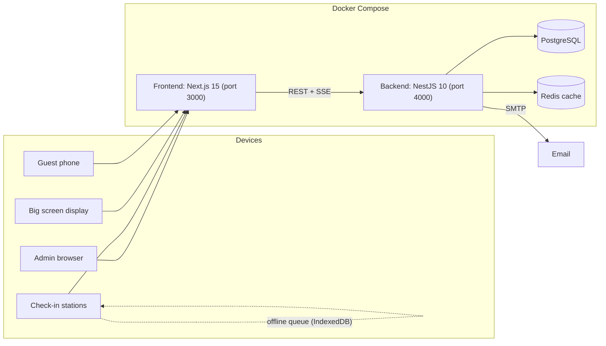

# Event Management System

**English** · [Bahasa Indonesia](README.id.md)

An event operations platform that covers the full guest journey: registration, QR check-in at one or more stations, a welcome screen on the big display, souvenir handout, lucky draws, and sports tournaments. It is built for corporate gatherings where hundreds or thousands of guests arrive in a short window and the check-in desk has to keep working even when the network does not. Current version: 1.6.0. The interface is in Indonesian.


## Contents

- [Features](#features)
- [Screens](#screens)
- [Architecture](#architecture)
- [Tech stack](#tech-stack)
- [Getting started](#getting-started)
- [Production deployment](#production-deployment)
- [Configuration](#configuration)
- [Operations](#operations)
- [Testing](#testing)
- [Project layout](#project-layout)
- [Documentation](#documentation)
- [License](#license)

## Features

### Events and guests

- Several events in one installation, with one active event at a time. Each event has its own branding (logo, background image or video, overlay), welcome message, and feature switches.
- Guest management with search and filters, Excel/CSV import and export, and email invitations that carry a personal QR code.
- Public self-registration page and a configurable landing page with hero images, features, and a gallery.

### Check-in

- QR check-in with the device camera, plus name search for guests who arrive without their code. When a name matches several guests, the operator picks the right one and confirms before check-in.
- Duplicate check-in detection and queue numbers.
- Multiple check-in stations, each with its own identity.
- Offline mode: when the connection drops, check-ins are queued in IndexedDB and synchronized automatically when it returns. Conflicts are resolved first-wins, duplicates are flagged, and everything lands in the audit trail. The queue warns at 80% and blocks at 100% of its configured limit.

### Live display

- Welcome animation on the public screen as each guest checks in, with real-time updates over server-sent events (SSE).
- Background video and custom overlays per event.

### Souvenirs and prizes

- Souvenir handout tracking, with live updates when guest data changes.
- Lucky draw with a big-screen display, two pacing presets (a quick "Hiburan" draw and a slower "Utama" grand prize draw), multi-winner draws, an eligible guest list, a winners page, and a prize carousel.
- Prize collection tracking.

### Tournaments

- Tournaments scoped to the active event and switched on per event.
- Sports: futsal, basketball, volleyball, badminton, chess, esports, and an "other" category.
- Formats: single elimination, double elimination, round robin, Swiss, and group stage followed by knockout. Team or individual participants, with simple, set-based, or point-based scoring, and manual or automatic scheduling.
- Teams built from existing guests, team logo upload, tournament check-in, and a live match display.

### Administration

- Dashboard and statistics, SMTP settings and email log, admin users, and a system page.
- Request IDs on every response, structured logs, and an operations metrics endpoint for use during the event.

## Screens

| Path | Purpose |
|---|---|
| `/admin` | Admin dashboard: events, guests, prizes, souvenirs, tournaments, statistics, settings, system |
| `/checkin` | Check-in station |
| `/show` | Public welcome display |
| `/souvenir` | Souvenir handout |
| `/luckydraw` | Lucky draw control and display (`/luckydraw/display`, `/luckydraw/winners`, `/luckydraw/carousel`) |
| `/register` | Public guest registration |
| `/tournament`, `/tournament-checkin`, `/live` | Brackets, tournament check-in, live match display |

## Architecture



In production, Nginx Proxy Manager terminates HTTPS in front of the frontend.

## Tech stack

| Layer | Technology |
|---|---|
| Frontend | Next.js 15, React 18, Tailwind CSS, React Query, html5-qrcode, QRCode.js, IndexedDB |
| Backend | NestJS 10, Prisma 5, PostgreSQL, Redis (cache-manager), Nodemailer, Winston |
| Realtime | Server-sent events |
| Tests | Jest (backend), Vitest (frontend) |
| Deployment | Docker Compose, Nginx Proxy Manager, Bash and Windows batch scripts |

## Getting started

Requirements: Node.js 18 or newer, PostgreSQL 14 or newer, and Redis. Docker is recommended.

### Backend

```bash
cd apps/backend
cp .env.example .env      # PORT, DATABASE_URL, JWT_SECRET, CORS_ORIGIN, optional HTTPS settings
npm install
npm run prisma:generate
npm run prisma:migrate
npm run seed              # creates the admin account
npm run dev               # http://localhost:4000
```

The seed reads `ADMIN_USERNAME` and `ADMIN_PASSWORD` from the environment and falls back to `admin` and a default password defined in `prisma/seed.ts`. Set your own values, or change the password right after the first login.

### Frontend

```bash
cd apps/frontend
cp .env.example .env      # NEXT_PUBLIC_API_BASE_URL
npm install
npm run dev               # http://localhost:3000
```

For local HTTPS (needed for camera access on other devices), use `docker-compose.dev-https.yml` together with `generate-ssl.bat` or `start-dev-docker-https.bat`.

## Production deployment

```bash
cp .env.production.example .env.production   # fill in every value
./deploy-prod.sh                             # Linux
deploy-prod.bat                              # Windows
```

The deploy script checks Docker and the required files, loads `.env.production`, and brings up PostgreSQL, Redis, the backend, and the frontend with `docker-compose.prod.yml`. The frontend is published on `FRONTEND_PORT` (default 3000) and joins the Nginx Proxy Manager network for HTTPS. `JWT_SECRET` and `ADMIN_PASSWORD` are required; compose refuses to start without them.

Updates run through `update.sh` or `update.bat`. [docs/DEPLOYMENT.md](docs/DEPLOYMENT.md) and [docs/DOCKER_DEPLOY.md](docs/DOCKER_DEPLOY.md) cover the details, and [docs/server-specification.md](docs/server-specification.md) lists the recommended server size.

## Configuration

`.env.production`:

| Variable | Description |
|---|---|
| `DB_USER`, `DB_PASSWORD`, `DB_NAME` | PostgreSQL credentials |
| `BACKEND_PORT` | Backend port |
| `REDIS_URL` | Redis connection |
| `JWT_SECRET` | Token signing secret. Required |
| `CORS_ORIGIN` | Allowed frontend origin |
| `ADMIN_USERNAME`, `ADMIN_PASSWORD` | Initial admin account. The password is required |
| `FRONTEND_PORT` | Published frontend port (default 3000) |
| `SMTP_HOST`, `SMTP_PORT`, `SMTP_USER`, `SMTP_PASS`, `SMTP_FROM` | Outgoing email for invitations |

Backend development settings (`apps/backend/.env`): `PORT` (default 4000), `DATABASE_URL`, `JWT_SECRET`, `CORS_ORIGIN`, and `USE_HTTPS`, `SSL_KEY_PATH`, `SSL_CERT_PATH` for HTTPS. Frontend: `NEXT_PUBLIC_API_BASE_URL`.

## Operations

[docs/RUNBOOK.md](docs/RUNBOOK.md) is the incident runbook for use during an event. Its rule of thumb: never stop the whole system to fix one problem, because the stations can keep working offline. The first three checks:

```bash
docker ps --filter "name=guest" --format "table {{.Names}}\t{{.Status}}"
curl -s http://localhost:4000/api/health
docker exec guest-backend-prod sh -c "tail -n 100 logs/error-$(date +%F).log"
```

Every response carries an `X-Request-Id` header that can be searched in the logs. Logged-in admins can read live attendance figures from `GET /api/ops/metrics`.

Backup and restore: `backup-docker.bat`, `restore-docker.bat`, and `docker-compose.restore.yml`. Windows helpers for firewall and port 80 conflicts are included (`fix-firewall.bat`, `fix-iis-port80.bat`, `fix-ultimate-firewall.bat`), as is `renew-ssl.bat`.

## Testing

```bash
cd apps/backend && npm test     # Jest
cd apps/frontend && npm test    # Vitest
```

[docs/TESTING.md](docs/TESTING.md) describes the test approach.

## Project layout

```
apps/
  backend/                NestJS API
    prisma/               schema, migrations, seed
    src/
      auth/  users/       authentication and admin users
      events/  guests/    events, guests, import and export
      stations/           check-in stations and offline sync
      souvenirs/ prizes/  souvenir handout and lucky draw
      tournaments/        tournaments, teams, matches, brackets
      public/ public-registration/ landing-page/   public endpoints and SSE
      reports/ email/ ops/ common/
  frontend/               Next.js app
    app/(main)/           admin, checkin, show, souvenir, luckydraw, register, tournament, live, about
    components/ lib/ hooks/
docs/                     architecture, API, schema, deployment, runbook, module notes
```

## Documentation

- [docs/ARCHITECTURE.md](docs/ARCHITECTURE.md), [docs/API.md](docs/API.md), [docs/DB_SCHEMA.md](docs/DB_SCHEMA.md)
- [docs/MULTI_STATION_OFFLINE_IMPLEMENTATION.md](docs/MULTI_STATION_OFFLINE_IMPLEMENTATION.md)
- [USER_GUIDE.md](USER_GUIDE.md) and [DOCUMENTATION.md](DOCUMENTATION.md)
- [CHANGELOG.md](CHANGELOG.md)

## License

This repository does not include a license file. Contact the author before reusing the code.

Developed by Yohanes Octavian Rizky ([@torpedoliar](https://github.com/torpedoliar)).
